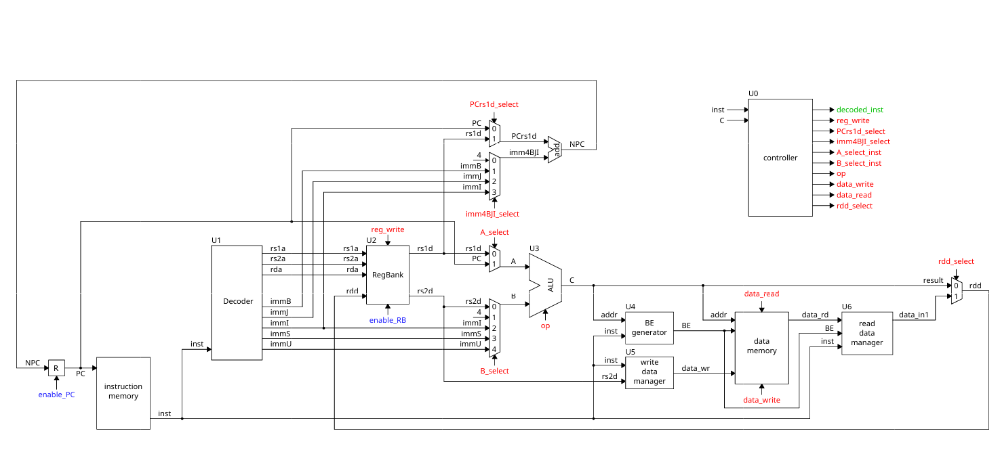
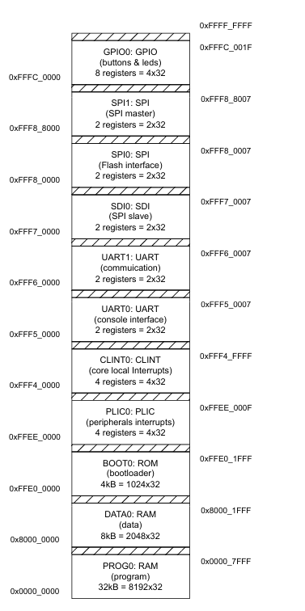
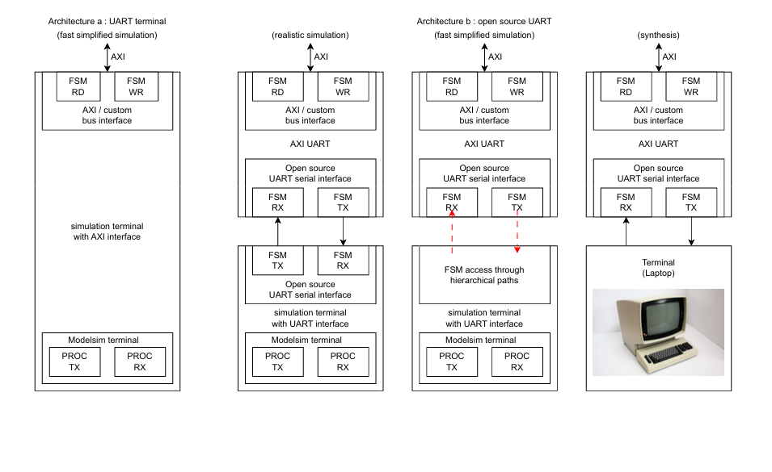
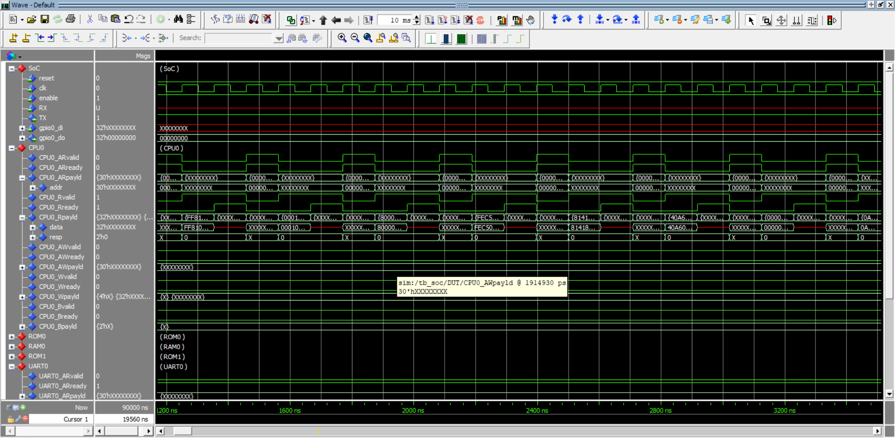

<h1 align="center">🧠 RISC-V RV32I Processor and AXI SoC in VHDL</h1>

<p align="center">
  
  
  
  
  
  
</p>

VHDL design of a **RISC-V RV32I single-cycle processor** and its **system on chip (SoC)**: a 5-channel **AXI** bus, ROM and RAM memories, a UART and a GPIO block. The project was carried out as a SoC design assignment (BE) at ENIT (Electrical Engineering), going from the arithmetic unit up to the complete SoC.

<p align="center"></p>

---

## 📦 1. Project content

| Stage | Content |
|---|---|
| 🔵 RISC-V core | ALU, register bank, decoder, controller, single-cycle datapath |
| 🟢 Memory interface | `BE_generator`, `write_data_manager`, `read_data_manager` (byte, half-word, word accesses) |
| 🟠 Basic SoC | Core + instruction and data buses, ROM, RAM, `.mem` initialization files |
| 🔴 AXI SoC | Multicycle AXI core, 1-master / 16-slave AXI bus, ROM, RAM, UART, GPIO |
| 🟣 Tools | ModelSim simulation, Vivado synthesis, RISC-V (GCC) toolchain |

---

## 🔵 2. The RISC-V RV32I core

- **RV32I** instruction set: 37 implemented instructions (10 R-type, 9 immediate arithmetic, 5 loads, 3 stores, 6 branches, `jal`, `jalr`, `lui`, `auipc`).
- **Single-cycle** architecture: one instruction per clock cycle.
- Byte-addressed memory, **little-endian**.

### Datapath

The controller drives multiplexers around the ALU and the next-address computation:

| Signal | Role | Values |
|---|---|---|
| `PCrs1d_select` | base of the next address | 0 = PC, 1 = rs1 |
| `imm4BJI_select` | offset added | 0 = 4, 1 = immB, 2 = immJ, 3 = immI |
| `A_select` | ALU operand A | 0 = rs1, 1 = PC |
| `B_select` | ALU operand B | 0 = rs2, 1 = 4, 2 = immI, 3 = immS, 4 = immU |
| `rdd_select` | data written into rd | 0 = ALU result, 1 = data read from memory |

Next address:

$$\color{green}{NPC = PCrs1d + imm4BJI}$$

### Memory interface

Byte and half-word accesses use **byte enables (BE)**:

| Access | address[1:0] = 00 | 01 | 10 | 11 |
|---|---|---|---|---|
| Byte (SB, LB, LBU) | 🟢 0001 | 🟢 0010 | 🟢 0100 | 🟢 1000 |
| Half-word (SH, LH, LHU) | 🟢 0011 | 🔴 misaligned | 🟢 1100 | 🔴 misaligned |
| Word (SW, LW) | 🟢 1111 | 🔴 misaligned | 🔴 misaligned | 🔴 misaligned |

- `write_data_manager` replicates the data on the 4 byte lanes.
- `read_data_manager` selects the useful bytes, then sign-extends (LB, LH) or zero-extends (LBU, LHU).

---

## 🟠 3. The SoC and its memory map

<p align="center"></p>

| Block | Role | Size | Addresses |
|---|---|---|---|
| 🔵 ROM0 | program | 32 KiB (8192×32) | `0x0000_0000` – `0x0000_7FFF` |
| 🟢 RAM0 | variables | 8 KiB (2048×32) | `0x8000_0000` – `0x8000_1FFF` |
| 🟠 ROM1 | constants | 8 KiB (2048×32) | `0x9000_0000` – `0x9000_1FFF` |
| 🟣 UART0 | serial console | 2 registers | `0xA000_0000` – `0xA000_0007` |
| 🔴 GPIO0 | buttons and LEDs | 2 registers | `0xB000_0000` – `0xB000_0007` |

The bus decodes the address and selects the slave. An address outside these ranges is flagged by `illegal_address`.

> 💡 The ROMs are initialized from `.mem` files (`ROM0.mem` for the program, `ROM1.mem` for the constants), generated from the assembly program by the toolchain (see "Programs").

---

## 🔴 4. The AXI bus

<p align="center"></p>

The bus follows the **AMBA AXI** principle: five independent channels, each with a `VALID` signal (sender) and a `READY` signal (receiver).

| Channel | Direction | Content |
|---|---|---|
| 🔵 AR | master → slave | read address |
| 🟢 R | slave → master | read data and response (`resp`) |
| 🟠 AW | master → slave | write address |
| 🟣 W | master → slave | write data and byte enables |
| 🔴 B | slave → master | write response |

**Handshake rule:** a transfer takes place on the clock edge where `VALID` and `READY` are both 1.

$$\color{green}{transfer} = \color{blue}{VALID} \wedge \color{orange}{READY}$$

> ⚠️ The sender does not withdraw its information until the transfer has happened.

**Responses:**

```diff
+ 00  OKAY
- 10  SLVERR
- 11  DECERR
```

### The AXI core (`RISCV32I_core_axi`)

The AXI core executes each instruction in several states: instruction request (AR), reception (R), execution, then, for a load or a store, a memory access (AR/R or AW/W/B). The program counter and the register bank are updated only at the end of the instruction.

Each slave (ROM, RAM, UART, GPIO) is also described by a small state machine: read (wait for AR, then send R) and write (wait for AW, then W, then send B).

---

## 🟣 5. Simulation

Compilation and simulation with **ModelSim SE-64 2020.4**.

<p align="center"></p>

The waveform shows the core fetching its instructions from the ROM: `ARvalid` requests the instruction, and `Rvalid` and `Rready` mark the data transfer.

---

## 📁 6. Repository structure

```
.
├── README.md
├── architecture_riscv.png
├── memory_map.png
├── Bus_AXI.png
├── simulation_modelsim.png
└── seance9/
    ├── vhdl/
    │   ├── riscv/           ALU, RegBank, decoder, controller, core, AXI core...
    │   ├── axi/             pack_axi_types, bus_axi_1x16
    │   ├── mem/             ROM, RAM (simple and AXI versions)
    │   ├── gpio/            gpio_axi
    │   ├── uart/            uart_rx, uart_tx, uart_axi
    │   └── soc/             soc, soc_fpga, testbench
    ├── modelsim/            compilation and simulation scripts
    └── prog/                test programs and .mem files
```

---

## ▶️ 7. Usage

### Compile and simulate (ModelSim)

In the ModelSim console, from the `seance9/modelsim` folder:

```tcl
do comp_soc.tcl      ;# compiles all libraries in order
do sim_soc.tcl       ;# starts the simulation
do wave_soc.tcl      ;# displays the main signals
```

Libraries used: 🔵 `axi_lib` (AXI types and bus), 🟢 `riscv_lib` (core), 🟠 `mem_lib` (memories), 🟣 `gpio_lib`, 🟤 `uart_lib`, 🔴 `soc_lib` (SoC and testbench).

### Programs

An assembly program is converted into `.mem` files with the RISC-V GCC toolchain (`riscv-none-elf-gcc`):

```bash
riscv-none-elf-gcc -march=rv32i -mabi=ilp32 -nostdlib -nostartfiles prog.s -T link2.ld -o prog.elf
riscv-none-elf-objdump -D prog.elf > prog.dis
riscv-none-elf-objcopy -O verilog --only-section=.program --verilog-data-width=4 prog.elf ROM0.mem
riscv-none-elf-objcopy -O verilog --only-section=.constants --verilog-data-width=4 prog.elf ROM1.mem
```

> 💡 The sections of the linker script (`link2.ld`) must match the SoC memory map (section 3).

### Synthesis (Vivado)

The Vivado project targets a **Zybo (xc7z010)** board. The SoC is instantiated in `soc_fpga.vhd`, with a 9.6 MHz clock generated by a `clk_wiz` and a 9600-baud serial link. The `ROM0.mem` and `ROM1.mem` files must be added to the project as memory files, and their names passed to the `PROGRAM_FILE_NAME` and `CONSTANTS_FILE_NAME` generics.

---

## 📊 8. Project status

| Part | Status |
|---|---|
| RV32I single-cycle core, memory interface, basic SoC | ✅ validated in ModelSim on test programs |
| AXI SoC (AXI core, bus, ROM, RAM, GPIO, UART) | 🟡 described in VHDL and compiled; Vivado synthesis run for the Zybo |
| Execution on the board | ⚪ not documented in this repository |

---

## 🛠️ 9. Tools

| Tool | Usage |
|---|---|
| 🔴 ModelSim SE-64 2020.4 | VHDL compilation and simulation |
| 🟣 Vivado 2025.2 | synthesis and implementation (Zybo, xc7z010) |
| 🟢 xPack `riscv-none-elf-gcc` | assembling and linking programs |
| 🔵 Ripes | writing and checking assembly programs |

---

## 👤 10. Author and acknowledgements

Project by **Chaanbi Hassen**, École Nationale d'Ingénieurs de Tunis (ENIT), Electrical Engineering.

Course material and assignment brief provided by the instructor; course diagrams are cited for reference.
